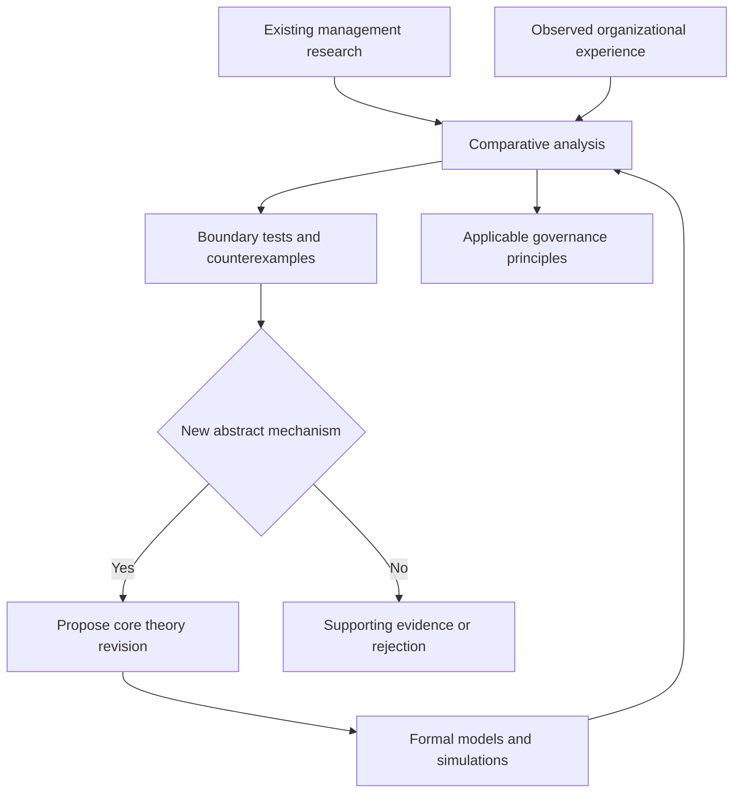

# Comparative Management Research

**Initiated:** 27 November 2026  
**Status:** Open research branch in the conceptual sense; stored on the existing main branch for now.

## Purpose

Investigate the individual's Manager and the corporate management function as possible different implementations of shared functional principles. The corporation externalizes management into rules, roles, processes, contracts and documentation, making mechanisms available for comparative examination. Treat corporate persistence, resource allocation, negotiation and learning as observable cases, not as proof of consciousness or universal equivalence.

The corporation may be regarded as a virtual body of rules in the author's framing. Distinguish the encoded organization from people, resources, infrastructure and enactment. The existing human stewardship definition remains in force pending explicit review of any generalization.

## Research index

| Document | Contents |
| --- | --- |
| [Index of equivalents](index-of-equivalents.md) | EQ-01–EQ-60, six functional domains |
| [Literature index](literature-index.md) | RT-01–RT-09, preliminary reading agenda |
| [Candidate mechanisms](candidate-mechanisms.md) | CM-01–CM-08, hypotheses and tests |
| [Research work register](research-work-register.md) | WP-01–WP-12, priorities and open branches |
| [Findings](findings/README.md) | Evidence, counterexamples and decisions |

## Established research connections

- [Manager, self and governing symbolic entities](../2026-11-24-manager-self-and-governing-symbolic-entities.md)
- [Persistence, surplus and responsibility](../2026-10-25-persistence-surplus-responsibility-bridge.md)
- [Symbolic entities across scales](../2026-11-24-symbolic-entities-cross-scale-boundary-tests.md)
- [Garden of Eden](../2026-10-25-garden-of-eden-recursive-enabling-environments.md)
- [Alignment market and symbolic trajectories](../2026-11-24-alignment-market-symbolic-proposals-and-trajectories.md)
- [Manager Theory and formal models](https://github.com/carstenbund/surplus-sim1/blob/main/research/01-manager-surplus.md)

## Method and boundaries

1. Extract the actual mechanism from a named source; distinguish evidence from interpretation.
2. Specify inputs, constraints, feedback, allocation and outcomes in each implementation. Compare corporate, individual and, where defensible, biological or technological instances.
3. Identify negative controls and counterexamples; similarity of outcomes is insufficient.
4. Compare the finding against existing abstractions before proposing an addition. A known mechanism in a new context is supporting material, not a reason to expand the core.
5. Preserve stable identifiers and record accept/revise/reject decisions with reasons.

Research-project-1 is the interim store. Separate the research into its own repository only if scope or independent tooling warrants it. Formal simulations remain in surplus-sim1; practical governance and dependency assessment instruments are separate applications. Feed back only genuinely new abstractions or necessary clarifications. Keep the operational governance core concise; the depth of assessment should be proportionate to consequences and uncertainty.

## Research provenance

Digest of the discussion on technical governance, created dependencies, proportionality, and comparative management, 27 November 2026. No literature review or cross-scale empirical test has yet been completed. Company-specific details and conjectures about particular suppliers are intentionally excluded from this public research collection.

