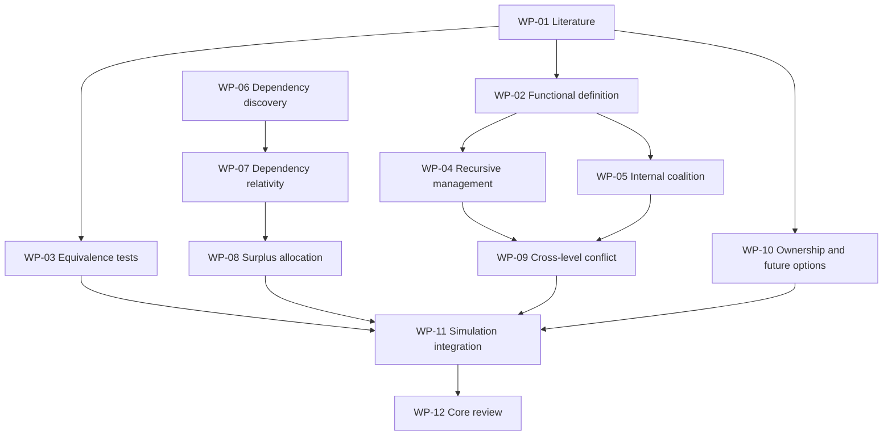

# Research work register

**Status:** Initial index, 27 November 2026. All work packages open. Completed discussion is not completed validation.

| ID | Work package | Scope | Expected evidence / outcome | Status |
| --- | --- | --- | --- | --- |
| WP-01 | Comparative literature review | Extract mechanisms from RT-01–09 | Source notes with original claims, evidence and scope | Open |
| WP-02 | Functional definition of the Manager | Identify minimum functions and distinguish execution environments | Proposed definition and boundary tests | Open |
| WP-03 | Comparative equivalence testing | Test EQ-01–60 across individual, corporate and suitable biological implementations | Evidence and counterexamples for each ID | Open |
| WP-04 | Recursive management | Investigate first-, second- and third-order management | CM-03 discriminating tests and relation to symbolic governance | Open |
| WP-05 | Internal coalition model | Investigate competing individual objectives and negotiation | Comparison with RT-05; test alternative accounts | Open |
| WP-06 | Dependency discovery methodology | Develop an independent assessment instrument | Discovery protocol, evidence states and controlled withdrawal tests | Open |
| WP-07 | Dependency relativity model | Formalize exposure, benefit, investigation effort and mitigation cost | Common-horizon model, uncertainty and stopping rules | Open |
| WP-08 | Surplus allocation model | Investigate production, exploration, protection and autonomy | Candidate allocation model, sensitivity and trade-offs | Open |
| WP-09 | Cross-level management conflict | Examine local persistence strategies and surrounding systems | Examples and discriminating mechanisms | Open |
| WP-10 | Future options and ownership | Investigate reversibility, commitments and control of anticipated futures | RT-08 comparison and practical/legal distinction | Open |
| WP-11 | Simulation integration | Determine whether new mechanisms warrant model extensions | Ablations and comparison against existing surplus models | Open |
| WP-12 | Core theory review | Accept, revise or reject candidates after comparative findings | Traceable decision record; no silent core edits | Open |

## Sequencing

Start WP-01 and WP-06 in parallel. WP-02/03 use the literature extraction. WP-04/05/07/10 refine candidate mechanisms; WP-08/09 depend on the relevant comparative findings. WP-11 follows candidate formalization, and WP-12 determines whether any core revision is warranted.

## Branch register

| Branch | Current state |
| --- | --- |
| Individual/corporate comparison | Opened and indexed |
| Economic and organizational literature | Opened, not reviewed systematically |
| Corporation as symbolic execution environment | Conceptual comparison only |
| Dependency, vulnerability and autonomy | Initial distinctions established |
| Proportionality and mitigation | Preliminary formulas |
| Recursive orders | Candidate |
| Internal coalition | Not investigated |
| Ownership and future decision authority | Not investigated |
| Governance expenditure | Not formalized |
| Cross-scale invariance | Not tested |
| Simulation integration | Pending |
| Core theory changes | Deferred |

## Applied research boundary

Dependency discovery and assessment should be developed independently from the governance framework. Discovery methods include static and runtime analysis, process mapping, contract and licence review, knowledge assessment and controlled withdrawal tests. Capture direct, transitive, shared and reverse dependencies; distinguish installation, operation, change, recovery and exit. Evaluate criticality, replaceability, interruption tolerance, cost and evidence. Unknowns remain explicit. Investigate and mitigate only proportionately, subject to non-negotiable constraints. Feed back new principles, not the entire methodology. The governance package remains unchanged.
